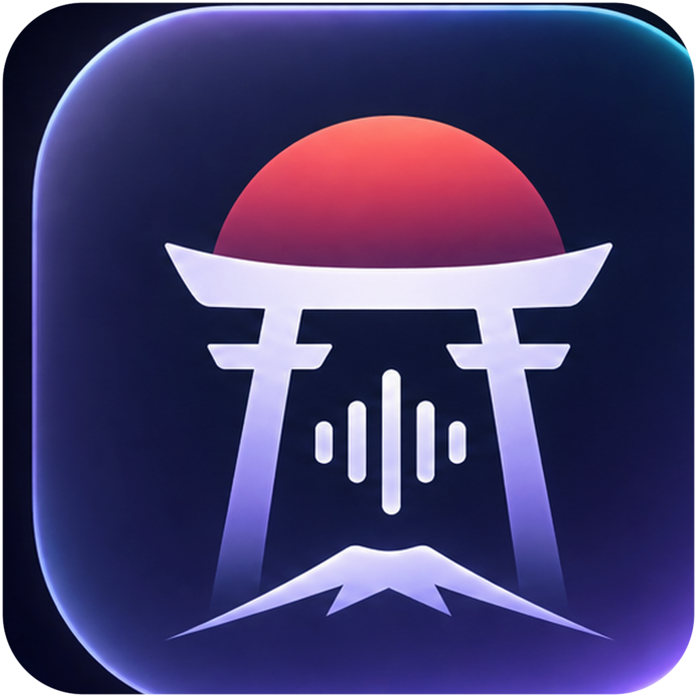

# kanso-dictate (簡素)

<p align="center"></p>

> **Kanso (簡素)**: Japanese aesthetic of simplicity, eliminating clutter to reveal the core essence.

A minimalist, high-performance, local-first macOS dictation assistant written in pure Swift 6, engineered from scratch for Apple Silicon (macOS 14+).

Commercial tools like Wispr Flow and Superwhisper wrap 120MB+ Electron containers, consume 300MB–500MB of RAM, lack offline on-device fallbacks, and lock users into third-party cloud subscriptions. `kanso-dictate` strips away framework bloat to expose the pure mechanics of native voice typing: low-level `CGEventTap` Push-To-Talk, zero-disk in-memory audio processing, Apple Neural Engine (ANE) CoreML acceleration, universal OpenAI-compatible remote streaming, and non-polluting synthetic pasteboard injection.

---

## Key Features & Capabilities

### 1. Pure Push-To-Talk (PTT) Interaction
- **Instant Hardware Key Interception**: Intercepts modifier key transitions for the standalone `Right Option` key (keycode `0x3D` / 61 decimal) using a low-level Quartz event tap (`CGEvent.tapCreate` on `.flagsChanged`).
- **Tactile Walkie-Talkie Feel**: Hold `Right Option` to speak, release to immediately transcribe and type into the active cursor position.
- **Micro-Tap Protection**: Accidental key bumps lasting under 300 milliseconds are discarded cleanly without triggering unnecessary inference calls or system alerts.
- **Auditory Cues**: Subtle native macOS audio feedback (`Tink` on recording start, `Pop` on completion) confirms state transitions without requiring visual attention.

### 2. Dual-Engine Speech-to-Text Architecture
- **Local On-Device Engine (WhisperKit)**:
  - Hardware-accelerated inference utilizing the Apple Silicon Neural Engine (ANE) and GPU via `argmax-inc/WhisperKit`.
  - 100% private and offline: audio bytes never touch the network.
  - Isolated inside a dedicated background `actor WhisperTranscriptionActor` off the main thread to prevent UI hitches during model loading and tensor evaluation.
  - Automatic model caching in `~/Library/Application Support/KansoDictate/models` (defaults to `openai_whisper-base` for sub-100ms chunk processing).
- **Remote Cloud Turbo Engine (OpenAI-Compatible + Free-Tier Engines)**:
  - Universal REST client supporting any endpoint implementing `/v1/audio/transcriptions` (Groq, OpenAI, Cloudflare, Ollama, self-hosted vLLM/LocalAI).
  - One-click presets for cheap drop-ins: Mistral Voxtral (`voxtral-mini-latest`), Fireworks AI (Whisper turbo), Together AI (Whisper Large v3).
  - First-class free-tier engines with isolated credentials: Google Gemini Developer API (free RPD, no card), Deepgram ($200 credit), Cloudflare Workers AI (daily free pool), AssemblyAI ($50), Speechmatics ($100 grant), Rev.ai (5 hrs), ElevenLabs Scribe.
  - Groq `whisper-large-v3-turbo` achieves sub-250ms round-trip transcription.
  - Multipart/form-data streaming constructed in memory with custom vocabulary prompt biasing and automatic endpoint URL normalization.
- **Dynamic Hot-Swapping**: Switch between Local CoreML and Remote Cloud modes on the fly from the Settings window without restarting the application.

### 3. Low-Level In-Memory Audio Pipeline
- **Zero Disk I/O**: Live microphone buffers are captured, converted, and packaged entirely in RAM, preventing flash storage wear and eliminating temporary file leaks.
- **Hardware-Agnostic Resampling**: Downsamples arbitrary microphone hardware formats (44.1kHz or 48kHz stereo/mono) into standard 16,000 Hz 1-channel mono Float32 arrays via `AVAudioConverter`.
- **In-Memory RIFF WAV Serialization**: Custom `WAVWriter` generates canonical 44-byte RIFF/WAVE containers with 16-bit linear PCM payloads in memory, simultaneously feeding local model tensors and remote multipart uploads.

### 4. Resilient, Safe Text Injection
- **Universal Application Support**: Types transcribed text into any active text field across macOS (Slack, Cursor, VS Code, Safari, Chrome, Terminal, Notes, Discord) by simulating `Cmd+V` (`0x09` with `kCGEventFlagMaskCommand`).
- **Transient Pasteboard Tagging**: Tags transient text items with de-facto standard clipboard flags:
  - `org.nspasteboard.TransientType`
  - `org.nspasteboard.AutoGeneratedType`  
  *Prevents third-party clipboard history managers (Raycast, Maccy, Alfred, Paste) from polluting your clipboard history with ephemeral dictation fragments.*
- **Concurrency-Guarded Clipboard Restore**: Captures a complete multi-type snapshot (`String: Data`) of existing clipboard contents before pasting. Restores the user's previous clipboard after a 200ms delay, guarded by a `changeCount` check to ensure user copies during the window are never overwritten.

### 5. Native macOS UI & Local Persistence
- **Unobtrusive Menu Bar Agent (`LSUIElement = true`)**: Runs with zero Dock icon clutter, drawing less than 40 MB of idle RAM.
- **Real-Time State Indicators**: Menu Bar icon dynamically tracks pipeline states: idle (`mic`), listening (`record.circle.fill`), transcribing (`hourglass`), and success (`checkmark.circle.fill`).
- **Local History Viewer**: Reverse-chronological history list in SwiftUI displaying timestamps, audio durations, engine badges, and one-click copy buttons.
- **Zero-Macro Local Storage**: Thread-safe JSON storage in `~/Library/Application Support/KansoDictate/history.json` with no fragile compiler plugins.

---

## Architectural Data Flow

```
[User holds Right Option]
          │
          ▼
┌─────────────────────────┐
│     EventTapManager     │ ──(flagsChanged / 0x3D)──► KeyDown: Play Tink
└─────────────────────────┘
          │
          ▼
┌─────────────────────────┐
│      AudioRecorder      │ ──(AVAudioEngine / 16kHz mono)──► In-Memory PCM Buffer
└─────────────────────────┘
          │
[User releases Right Option] ──► KeyUp: Play Pop
          │
          ▼
┌─────────────────────────┐
│   DictationCoordinator  │ ──(Micro-Tap Guard: Duration >= 0.3s)
└─────────────────────────┘
          │
          ├──► Mode = Local  ──► [WhisperKitEngine (ANE CoreML)]
          └──► Mode = Remote ──► [OpenAICompatibleSTTEngine (Groq/OpenAI)]
          │
          ▼ (TranscriptionResult)
┌─────────────────────────┐
│       TextInjector      │
└─────────────────────────┘
          ├──► Snapshot existing NSPasteboard items
          ├──► Stage text with org.nspasteboard.TransientType
          ├──► Synthesize Cmd+V via CGEvent
          ├──► Append to HistoryStore (history.json)
          └──► Restore user clipboard after 200ms (guarded by changeCount)
```

---

## Quickstart & Installation

### Option 1: Install Release Binary (Recommended)

1. Download the latest release archive (`Kanso-Dictate-v0.2.0-macos-arm64.zip`) from [Releases](https://github.com/amaldevice/kanso-dictate/releases).
2. Unzip and drag `Kanso Dictate.app` into `/Applications`.
3. Open **Kanso Dictate** via Spotlight (`Cmd + Space`).
4. Open **Settings...** from the menu bar. Enable **Accessibility** for app control/text insertion and **Input Monitoring** for the global Option hotkey under System Settings → Privacy & Security; refresh status in Settings.

### Option 2: Build from Source (1-Line Local Install)

Prerequisites: macOS 14+ on Apple Silicon with Xcode Command Line Tools installed (`xcode-select --install`).

```bash
# Clone the repository
git clone https://github.com/amaldevice/kanso-dictate.git
cd kanso-dictate

# Build optimized release binary and install to /Applications
./scripts/build-app.sh release && rm -rf "/Applications/Kanso Dictate.app" && cp -R ".build/bin/Kanso Dictate.app" /Applications/

# Launch the app
open "/Applications/Kanso Dictate.app"
```

### Stable Signing (recommended)

macOS ties privacy grants (Accessibility, Input Monitoring, Microphone) to the app's **code-signing identity**. With ad-hoc signing (the default), every rebuild produces a new identity, so macOS silently revokes all three permissions after each reinstall — the System Settings toggle still shows ON while the app reports "Not Granted". Sign with a stable certificate so grants survive rebuilds:

1. **One-time**: open Keychain Access → Certificate Assistant → **Create Certificate…**
   - Name: e.g. `Kanso Dictate Dev Signing`
   - Identity Type: *Self-Signed Root*, Certificate Type: *Code Signing*
2. **Build with the identity**:
   ```bash
   KANSO_CODESIGN_IDENTITY="Kanso Dictate Dev Signing" ./scripts/build-app.sh release
   ```
   A Developer ID certificate works identically if you have one. Set `KANSO_CODESIGN_KEYCHAIN` to an explicit keychain path when the identity does not live in your login keychain (CI, temp keychains).
3. **Verify** the identity is stable (must show `certificate leaf`, not `cdhash`):
   ```bash
   codesign -d -r- "/Applications/Kanso Dictate.app"
   # designated => identifier "com.amaldevice.KansoDictate" and certificate leaf = H"…"
   ```

### App Icon

The Dock/Finder icon is built from the design source art in `docs/assets/` (the source ships with a glow that escapes the tile; the pipeline masks it to a clean rounded square). To regenerate after updating the art:

```bash
swift scripts/make-icon.swift docs/assets/kanso-dictate-icon-simplified.png Sources/KansoDictate/Resources/AppIcon.icns
```

---

## How to Dictate

1. Place your cursor in any text area (editor, browser, chat, or terminal).
2. **Hold down the `Right Option` key** (⌥ on the right side of your spacebar). You will hear a subtle *Tink* sound indicating recording has started.
3. **Speak naturally**.
4. **Release the `Right Option` key**. You will hear a *Pop* sound. The transcribed text will instantly type into your active text field.
5. Your previous clipboard contents remain completely safe and untouched.

---

## Troubleshooting: "Not Granted" but System Settings Shows ON

**Symptom:** Accessibility, Input Monitoring, or Microphone shows *Not Granted* in Kanso Dictate's Settings even though the app's toggle is ON in System Settings → Privacy & Security. The in-app Permissions section surfaces this case with a recovery hint.

**Cause:** macOS TCC ties each privacy grant to the app's **code-signing identity**. Every build of an ad-hoc-signed app gets a new identity, so after installing a newer build the stored grant no longer matches — System Settings keeps displaying the old entry with the toggle ON, while the app (correctly) reports it is not authorized.

**Fix — remove and re-add the entry** (toggling off and on is *not* enough):

1. System Settings → Privacy & Security → the affected permission (Accessibility / Input Monitoring / Microphone).
2. Select **Kanso Dictate** in the list, click **−** to remove it.
3. Click **+**, re-add Kanso Dictate, and enable the toggle.
4. Back in the app, the status flips to Granted within a second while its Settings window is open; the hotkey tap starts automatically (or use **Restart Hotkey Tap** in the menu bar).

Or reset via the command line, then grant again when prompted:

```bash
tccutil reset Accessibility com.amaldevice.KansoDictate
tccutil reset ListenEvent com.amaldevice.KansoDictate
tccutil reset Microphone com.amaldevice.KansoDictate
```

**Prevention:** build releases with a stable signing identity (see [Stable Signing](#stable-signing-recommended)) — grants then survive every rebuild and upgrade.

> **Note for contributors:** running the raw binary via `swift run KansoDictate …` creates a *second* TCC identity (the unpackaged executable) separate from the installed `.app`. A grant given to one does not apply to the other — they appear as separate entries in System Settings.

---

## Command-Line Verification & Diagnostic Suite

Kanso Dictate includes a built-in CLI diagnostic harness to test subsystems directly in your terminal:

```bash
# 1. Run full 23-assertion deterministic test suite (< 0.5s)
swift run KansoCoreTests

# 2. Test microphone hardware capture and peak/RMS volume (3-second sample)
swift run KansoDictate --test-mic

# 3. Test remote STT transcription against Groq or OpenAI
swift run KansoDictate --test-remote <YOUR_GROQ_OR_OPENAI_API_KEY>

# 3b. Test any free-tier engine key (gemini|deepgram|cloudflare|assemblyai|speechmatics|revai|elevenlabs; cloudflare takes "<accountId>:<apiToken>")
swift run KansoDictate --test-engine gemini <YOUR_GEMINI_API_KEY>

# 4. Test synthetic text injection and clipboard restoration into active window
swift run KansoDictate --test-inject "Hello from Kanso Dictate!"
```

---

## Project Structure

```text
kanso-dictate/
├── Package.swift                               # Dual-target Swift 6 package definition
├── scripts/
│   ├── build-app.sh                            # Automated .app packager with codesign
│   └── make-icon.swift                         # Art → masked .icns icon pipeline
├── Sources/
│   ├── KansoCore/                              # Core domain & infrastructure library
│   │   ├── Audio/
│   │   │   ├── AudioRecorder.swift             # AVAudioEngine downsampler (16kHz mono)
│   │   │   └── WAVWriter.swift                 # In-memory 44-byte RIFF/WAV encoder
│   │   ├── Coordinator/
│   │   │   └── DictationCoordinator.swift      # Pipeline state machine (@MainActor)
│   │   ├── Engines/
│   │   │   ├── OpenAICompatibleSTTEngine.swift # Remote REST multipart STT client
│   │   │   └── WhisperKitEngine.swift          # Local Apple Neural Engine CoreML engine
│   │   ├── Hotkey/
│   │   │   └── EventTapManager.swift           # CGEventTap Right Option PTT listener
│   │   ├── Injection/
│   │   │   └── TextInjector.swift              # Transient pasteboard & synthetic Cmd+V
│   │   ├── Models/
│   │   │   ├── STTProviderMode.swift           # Domain enum (.local vs .remote)
│   │   │   └── TranscriptionResult.swift       # Result model
│   │   ├── Protocols/
│   │   │   ├── AudioRecordingService.swift     # Audio recorder interface seam
│   │   │   └── SpeechToTextEngine.swift        # Polymorphic STT engine seam
│   │   └── Storage/
│   │       └── HistoryStore.swift              # Thread-safe JSON history persistence
│   └── KansoDictate/                           # Executable macOS Menu Bar application
│       ├── App/
│       │   └── KansoDictateApp.swift           # SwiftUI MenuBarExtra entry point
│       ├── Views/
│       │   ├── HistoryView.swift               # Reverse-chronological history window
│       │   └── SettingsView.swift              # Preferences & permission manager
│       ├── Resources/
│       │   ├── Info.plist                      # LSUIElement = true & mic descriptions
│       │   └── KansoDictate.entitlements       # Audio input & network entitlements
│       └── main.swift                          # CLI dispatcher & app runner
├── Tests/
│   └── KansoCoreTests/
│       └── main.swift                          # 23 end-to-end and unit test suites
└── docs/
    ├── clone-implementation-plan.md            # Architecture roadmap & planning
    ├── wispr-flow-analysis.md                  # Complete Wispr Flow reverse engineering dossier
    └── research/                               # Primary-source research reports
        ├── cgeventtap-ptt.md                   # CGEventTap & TCC permission findings
        └── whisperkit-integration.md           # WhisperKit ANE integration findings
```

---

## License

MIT License. Crafted with simplicity and precision for macOS.
