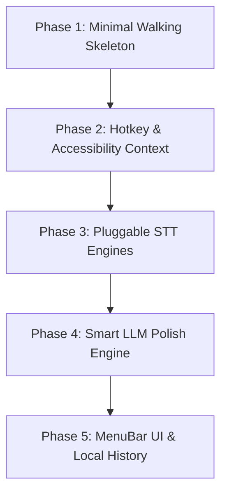

# Kanso Dictate: Implementation Plan & Engineering Roadmap

A lightweight, local-first macOS dictation assistant inspired by Wispr Flow.

---

## 1. Project Overview & Objectives

### Vision
A native macOS menu-bar utility that brings the "Wispr Flow experience" (push-to-talk dictation, AI text cleanup, and automatic text insertion) with **zero cloud lock-in**, running either **100% locally on Apple Silicon (WhisperKit / CoreML / MLX)** or via **high-speed remote inference providers (Groq / OpenAI / Custom Endpoints)**.

### Core Tenets
1. **Lean & Fast**: Pure Swift application (< 50 MB RAM, instant cold boot, zero Electron/WebKit bloat).
2. **Local-First & Private**: Works completely offline on Apple Silicon Neural Engine (ANE) without sending audio over the network unless explicitly configured.
3. **App-Aware Formatting**: Adjusts formatting based on target application (Markdown/code for IDEs/Terminals, conversational for Slack/chat).
4. **Resilient Insertion**: Reliable text injection via macOS Accessibility (`AXUIElement`) and simulated keystrokes (`CGEvent`), preserving existing clipboard data.

---

## 2. Technology Stack & Key Decisions

| Subsystem | Technology | Rationale & Trade-offs |
|---|---|---|
| **App Framework** | Swift 6 / SwiftUI (`MenuBarExtra` + AppKit) | Lowest memory footprint, native menu bar integration, direct access to C/macOS system APIs without FFI overhead. |
| **Audio Engine** | `AVAudioEngine` / CoreAudio | Real-time 16 kHz mono linear PCM acquisition with low-latency ring buffer. |
| **Global Shortcuts** | `CGEventTap` & `IOHIDManager` | Supports both Push-To-Talk (hold-to-speak) and Toggle modes, including hardware modifier keys (Fn/Globe, Right Option). |
| **Accessibility & Context** | `ApplicationServices` (`AXUIElement`) | Queries active window, focused textbox, and surrounding text context without switching app focus. |
| **Text Insertion** | `NSPasteboard` + `CGEvent` (`Cmd+V`) | Universal compatibility across web browsers, Electron apps, terminals, and native AppKit controls. |
| **Local STT Engine** | `WhisperKit` (Argmax OSS) / CoreML | Hardware-accelerated inference utilizing the Apple Silicon Neural Engine (ANE) and GPU. |
| **Remote STT Engine** | URLSession (Groq, OpenAI, Cloudflare, Custom API) | Groq `whisper-large-v3-turbo` achieves sub-250ms latency for users preferring cloud speed. |
| **Text Polishing** | Ollama / MLX Swift (Local) or Groq / OpenRouter (Remote) | Lightweight LLM cleanup (e.g. Qwen2.5-3B, Llama-3.2-3B) with specialized system prompt. |
| **Persistence** | `SwiftData` / SQLite | Local history of dictations, latency metrics, and custom vocabulary. |

---

## 3. Architecture & Data Flow

```
┌────────────────────────────────────────────────────────────────────────┐
│                        Kanso Dictate (Process)                         │
│                                                                        │
│   ┌────────────────────┐                   ┌───────────────────────┐   │
│   │  EventTapManager   │──[PTT Down]──────►│     AudioRecorder     │   │
│   │(Global Hotkey/PTT) │                   │(AVAudioEngine 16kHz)  │   │
│   └─────────┬──────────┘                   └───────────┬───────────┘   │
│             │ [PTT Down]                               │ [PTT Up]      │
│             ▼                                           ▼ [PCM/WAV]    │
│   ┌────────────────────┐                   ┌───────────────────────┐   │
│   │AccessibilityContext│                   │   STT Engine Router   │   │
│   │(AXUIElement State) │                   │ (WhisperKit / Groq)   │   │
│   └─────────┬──────────┘                   └───────────┬───────────┘   │
│             │                                           │               │
│             │ [Target App, Context Text]                ▼ [Raw Text]    │
│             │                              ┌───────────────────────┐   │
│             └─────────────────────────────►│    Text Polisher      │   │
│                                            │ (Local / Remote LLM)  │   │
│                                            └───────────┬───────────┘   │
│                                                         │ [Clean Text]  │
│                                                         ▼               │
│   ┌────────────────────┐                   ┌───────────────────────┐   │
│   │    HistoryStore    │◄──────────────────│     TextInjector      │   │
│   │    (SwiftData)     │                   │  (NSPasteboard/Cmd+V) │   │
│   └────────────────────┘                   └───────────────────────┘   │
└────────────────────────────────────────────────────────────────────────┘
```

---

## 4. Component Specifications

### 4.1. Audio Pipeline (`AudioRecorder`)
- **Format**: 16,000 Hz, 16-bit Linear PCM, Mono (standard Whisper format).
- **Buffer**: Circular lock-free ring buffer (capacity: 60 seconds).
- **VAD (Voice Activity Detection)**: Energy-based silence detection or Silero VAD to detect pauses.
- **Export**: Generates standard in-memory WAV container ready for local tensor input or HTTP multipart payload.

### 4.2. Hotkey & Input Monitor (`EventTapManager`)
- **Modes**:
  1. *Push-To-Talk (PTT)*: KeyDown starts recording; KeyUp terminates recording and initiates insertion.
  2. *Toggle Mode*: First press starts; second press stops.
- **Implementation**:
  - `CGEvent.tapCreate(tap: .cgSessionEventTap, place: .headInsertEventTap, options: .defaultTap, eventsOfInterest: [.keyDown, .keyUp, .flagsChanged], ...)`
  - Monitors modifier key transitions for dedicated Fn or Right-Option triggers.

### 4.3. Accessibility & Context Engine (`AccessibilityContext`)
- When recording begins:
  1. Captures frontmost application PID via `NSWorkspace.shared.frontmostApplication`.
  2. Obtains focused element: `AXUIElementCopyAttributeValue(systemWide, kAXFocusedUIElementAttribute)`.
  3. Extracts caret context:
     - `kAXSelectedTextRangeAttribute` (Selection start & length)
     - `kAXValueAttribute` or `AXUIElementCopyParameterizedAttributeValue(..., kAXStringForRangeParameterizedAttribute, ...)`
  4. Identifies application personality:
     - Code Editor (`com.microsoft.VSCode`, `com.todesktop.230313mzl4w4u92` / Cursor, `com.apple.dt.Xcode`)
     - Terminal (`com.apple.Terminal`, `com.googlecode.iterm2`, `dev.warp.Warp-Stable`)
     - Chat (`com.tinyspeck.slackmacgap`, `ru.keepcoder.Telegram`, `com.hnc.Discord`)
     - Document / Email (`com.apple.Notes`, `com.google.Chrome`)

### 4.4. Speech-to-Text Abstraction (`SpeechToTextProtocol`)
```swift
public protocol SpeechToTextEngine: Sendable {
    var id: String { get }
    var displayName: String { get }
    var isLocal: Bool { get }
    
    func transcribe(audioData: Data, language: String?, prompt: String?) async throws -> String
}
```
Implementations:
1. `WhisperKitEngine`: Uses Argmax WhisperKit with CoreML execution provider (`whisper-base.en` or `whisper-small`).
2. `GroqWhisperEngine`: Sends `audio/wav` to `https://api.groq.com/openai/v1/audio/transcriptions` (`model: whisper-large-v3-turbo`).
3. `OpenAIWhisperEngine`: Standard OpenAI API endpoint.
4. `CustomSTTEngine`: Configurable base URL, API key, and model name for self-hosted Whisper/vLLM.

### 4.5. Text Polisher & Formatter (`TextPolisherProtocol`)
```swift
public protocol TextPolisher: Sendable {
    func polish(
        rawText: String,
        context: InsertionContext
    ) async throws -> String
}
```
**System Prompt Strategy**:
```text
You are an inline dictation formatter.
Target Application: {appName} ({appCategory})
Surrounding Context: "{beforeCursorText}[CURSOR]{afterCursorText}"

Instructions:
1. Fix grammar, capitalization, and punctuation.
2. Remove verbal filler words (um, uh, like, you know).
3. Format appropriately for the target application:
   - If Terminal/IDE: use code terms, identifiers, flags, or shell commands as appropriate.
   - If Chat/Email: use natural conversational tone.
4. DO NOT answer questions, converse, or add commentary.
5. Return ONLY the cleaned, finalized text.
```

### 4.6. Text Injection & Pasteboard Safety (`TextInjector`)
1. **Clipboard Snapshot**: Read existing `NSPasteboard.general` items (types, strings, data).
2. **Re-activate Target**:
   ```swift
   targetApp.activate(options: [.activateIgnoringOtherApps])
   ```
3. **Set Content**:
   ```swift
   let pasteboard = NSPasteboard.general
   pasteboard.clearContents()
   pasteboard.setString(text, forType: .string)
   ```
4. **Synthesize Keystroke**:
   ```swift
   let source = CGEventSource(stateID: .combinedSessionState)
   let keyDown = CGEvent(keyboardEventSource: source, virtualKey: 0x09, keyDown: true) // 0x09 = ANSI 'V'
   keyDown?.flags = .maskCommand
   let keyUp = CGEvent(keyboardEventSource: source, virtualKey: 0x09, keyDown: false)
   keyUp?.flags = .maskCommand
   
   keyDown?.post(tap: .cghidEventTap)
   keyUp?.post(tap: .cghidEventTap)
   ```
5. **Restore Previous Clipboard**: Schedule restoration after a 100ms async delay to avoid race conditions with target app read operations.

---

## 5. Phased Implementation Roadmap



### Phase 1: Minimal Walking Skeleton
**Goal**: Record audio on keyboard command, call a remote STT endpoint (Groq/OpenAI), and paste into the active app.
- [ ] Initialize Swift Package / Xcode project (`KansoDictate`).
- [ ] Implement `AudioRecorder` using `AVAudioEngine` (16kHz mono).
- [ ] Implement `TextInjector` with `NSPasteboard` and synthetic `Cmd+V`.
- [ ] Implement basic `GroqWhisperEngine` via `URLSession`.
- [ ] Verification Gate: Run CLI/prototype; trigger 5s recording; verify text successfully appears in TextEdit.

### Phase 2: Hotkey & Accessibility Context
**Goal**: Push-to-talk background operation with zero window activation, capturing target app context.
- [ ] Implement `EventTapManager` (`CGEventTap`) for global KeyDown / KeyUp handling.
- [ ] Add TCC Permission manager (requesting Accessibility & Microphone permissions).
- [ ] Implement `AccessibilityContext` to capture active PID, bundle ID, and caret text.
- [ ] Integrate safe clipboard restore logic (`DelayedClipboard`).
- [ ] Verification Gate: In Slack or Cursor, hold hotkey, speak, release; verify audio stops and target app receives text while retaining previous clipboard content.

### Phase 3: Pluggable STT Engines (Local & Remote)
**Goal**: Support both local offline inference (Apple Neural Engine) and custom cloud APIs.
- [ ] Define `SpeechToTextProtocol`.
- [ ] Integrate `WhisperKit` package via SPM for local CoreML inference.
- [ ] Implement model downloader / manager for local models (`whisper-base.en`, `whisper-small`).
- [ ] Implement `OpenAIWhisperEngine` & `CustomSTTEngine` (compatible with LocalAI, vLLM, Whisper.cpp server).
- [ ] Verification Gate: Disconnect Wi-Fi; perform dictation using local WhisperKit; verify accurate offline transcription.

### Phase 4: Smart LLM Polish & App-Aware Formatting
**Goal**: Transform raw verbatim transcripts into polished, context-aware text without filler words.
- [ ] Define `TextPolisherProtocol`.
- [ ] Implement remote polishers (Groq `llama-3.1-8b-instant`, OpenRouter, OpenAI `gpt-4o-mini`).
- [ ] Implement local polisher via Ollama REST API (`/api/generate` with `qwen2.5:3b`) or native MLX Swift.
- [ ] Add application category heuristic mappings (IDE vs Terminal vs Chat vs Document).
- [ ] Verification Gate: Dictate "um so like git commit minus m quotes fix bug quotes" into Terminal; verify output formats cleanly as `git commit -m "fix bug"`.

### Phase 5: MenuBar UI, History & Settings
**Goal**: Native macOS user interface and local persistence.
- [ ] Implement `MenuBarExtra` status icon showing recording state (idle, listening, processing).
- [ ] Implement Settings Window in SwiftUI (API Keys, Engine Selector, Custom Vocabulary, Hotkey Picker).
- [ ] Implement `HistoryStore` using `SwiftData` (timestamps, audio duration, raw vs polished text, latency).
- [ ] Add sound effects for dictation start/stop (CoreAudio system sound synthesis).
- [ ] Verification Gate: Perform full end-to-end smoke test through MenuBar UI, change hotkeys, inspect history logs.

---

## 6. Critical Platform Challenges & Mitigations

### 1. macOS TCC Permissions (Accessibility & Input Monitoring)
- **Challenge**: `CGEventTap` and `AXUIElement` require explicit Accessibility and Input Monitoring permissions in macOS System Settings. If missing, calls silently return `null` or crash.
- **Mitigation**: Implement proactive authorization checkers (`AXIsProcessTrustedWithOptions`, `IOHIDCheckAccess`). If untrusted, present a dedicated onboarding window guiding the user directly to the relevant System Settings pane.

### 2. Clipboard Race Conditions
- **Challenge**: If the clipboard is restored too quickly after sending `Cmd+V`, the receiving app might paste the restored clipboard item instead of the dictated text.
- **Mitigation**: Enforce an asynchronous cooldown (100–150ms) before writing the backup back to `NSPasteboard`, matching Wispr Flow's observed `DelayedClipboardProvider` pattern.

### 3. Chromium / Electron Accessibility Quirks
- **Challenge**: Chromium-based apps (Chrome, Slack, VSCode, Cursor) sometimes delay populating `AXValue` or report empty text areas unless accessibility is active.
- **Mitigation**: Send `AXEnhancedUserInterface = true` attribute and gracefully fall back to empty context without blocking the dictation flow.

---

## 7. Immediate Next Steps

1. Create Xcode project / Swift Package structure in current workspace.
2. Build Phase 1 walking skeleton (`AudioRecorder` + `GroqWhisperEngine` + `TextInjector`).
3. Verify basic end-to-end injection cycle.
